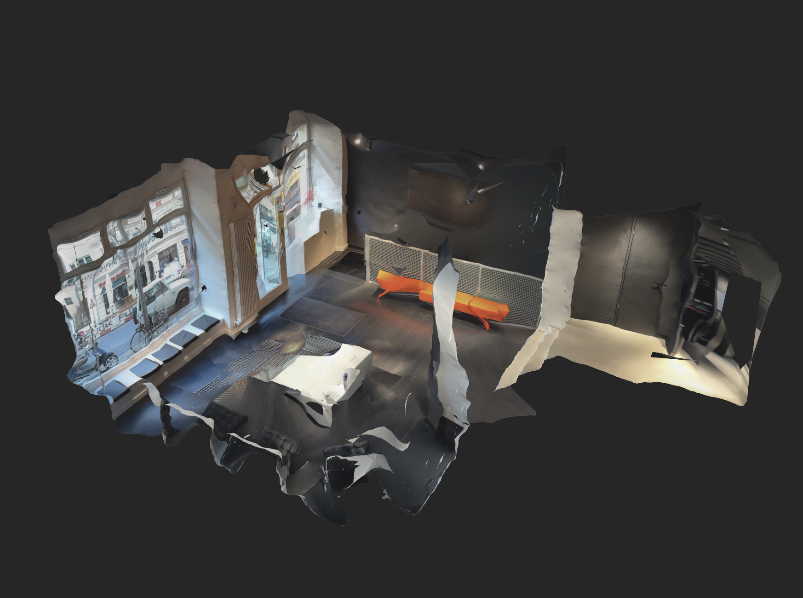
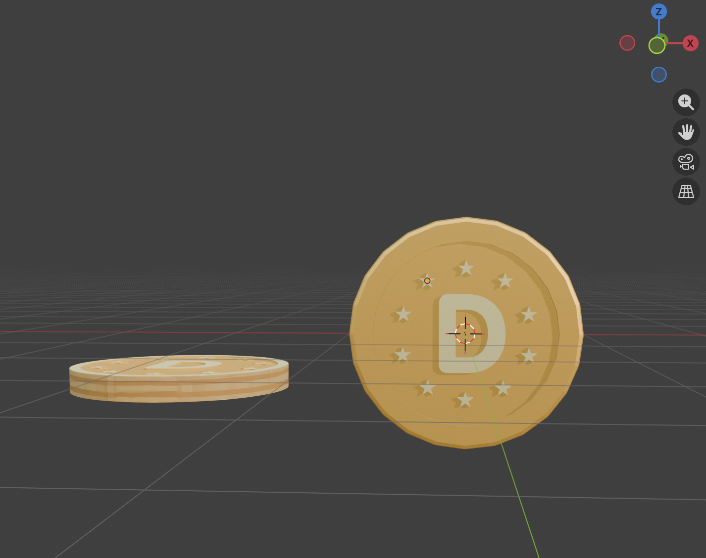

# AR Gift Unlock

A browser-based AR treasure hunt I built in 12 days for **weDISCOVR**'s in-person investor demo (April 2026), running on an iPhone 16 Pro in Safari. This is my portfolio version of that work: branding is placeholder and the backend runs on a mock API.

**Live demo:** _coming soon_

On a laptop, the demo runs inside a 3D iPhone with a simulated motion sensor. Move your cursor to tilt it. On a phone, the site opens the full app, which uses the phone's own camera and motion sensor.

## The experience

Explorers move through a real space in three stops. At each stop they get a clue and a 3D map of the room, find the next QR code and scan it to collect DISC points. The final scan unlocks a gift that appears in AR over the camera feed. Devices without a motion sensor get a fallback experience.

## Skills demonstrated

### Design in code and Figma

I designed directly in code, then used the Figma MCP to pull the live build into Figma. Working on the real screens there, I reworked alignment, hierarchy and which elements to show, then carried the changes back into code.

### Production code

- React + Vite with a token-based CSS system (CUBE CSS), where colours and spacing come from design tokens.
- Run state is derived from the backend's API shape, and the mock API mirrors the real contracts, so components stay the same when the live backend is connected.
- The fallback was built first, as the brief's "demo insurance".

### Adapting the brief

The brief asked for location-driven checkpoints. GPS is unreliable indoors, and a visual positioning system (VPS) wasn't buildable in 12 days, so I proposed QR codes as the checkpoint mechanism. The client accepted.

### Safari and device performance

- Researched the iPhone 16 Pro's capabilities and built Safari-first: motion-sensor permission and audio unlocked inside a tap, `dvh` units, safe-area insets, `-webkit-backdrop-filter`.
- Kept 3D assets small from the start. Every model is run through an optimiser (meshopt compression, all under 400 KB) and render resolution is capped at 2×. The demo ran smoothly on the device.
- Designed around the person holding the phone. A live camera feed with 3D rendering on top makes a phone run hot and drains its battery fast, so the camera switches off after two minutes idle. Reduced-motion preferences are respected throughout.
- Haptic feedback on checkpoint finds was planned however safari has no Vibration API, so I dropped it.

### 3D experiences with Three.js

- The AR gift reveal is composited over the live camera feed and driven by the phone's motion sensor.
- An interactive 3D map of the room, plus coin and confetti animations sequenced with GSAP.

### 3D modelling in Blender

I modelled the coin, gift box, room map, location pin and confetti by hand in Blender. The product model started from a generator, which garbled the label text, so I repainted the label texture by hand. For the room, I scanned the investor venue with Scaniverse. Cleaning up the raw scan would have taken too long for a 12-day build, so I modelled a simplified room using the scan as reference.

| Scaniverse scan of the venue                                         | Coin in Blender                                         |
| -------------------------------------------------------------------- | ------------------------------------------------------- |
|  |  |

### Copy

I wrote the clues, placing each one around where its QR code would sit in the real space, and the error states, such as the camera access prompts.

## About this version

- On mouse and trackpad devices, `/` shows the iPhone showcase. On phones, it shows the real app.
- Brand logos, names and product imagery are placeholders.
- Use the **DEMO only: use fake QR** button to skip scanning.

## Run locally

```bash
npm install
npm run dev
```

The dev server runs over HTTPS, which camera access requires. To test on a phone on the same network, set `DEV_HTTPS_SAN=<your LAN IP>` in `.env.local`.

## Credits

- [`public/3DModels/iphone_16_pro_max-optimized.glb`](public/3DModels/iphone_16_pro_max-optimized.glb): "[iPhone 16 Pro Max](https://skfb.ly/pqWYx)" by MajdyModels is licensed under [Creative Commons Attribution](http://creativecommons.org/licenses/by/4.0/). Modified for this project.
